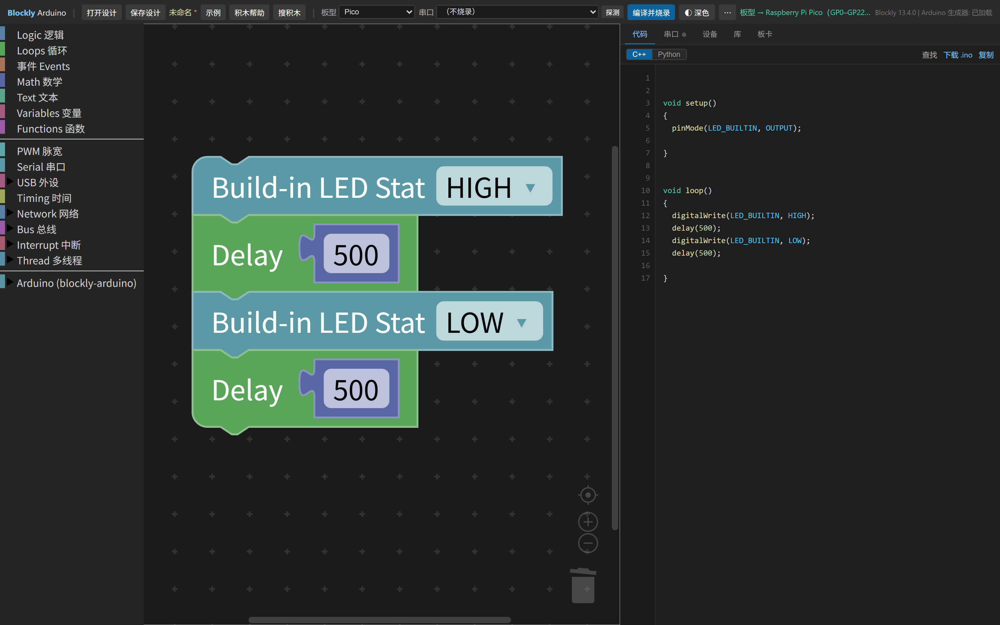
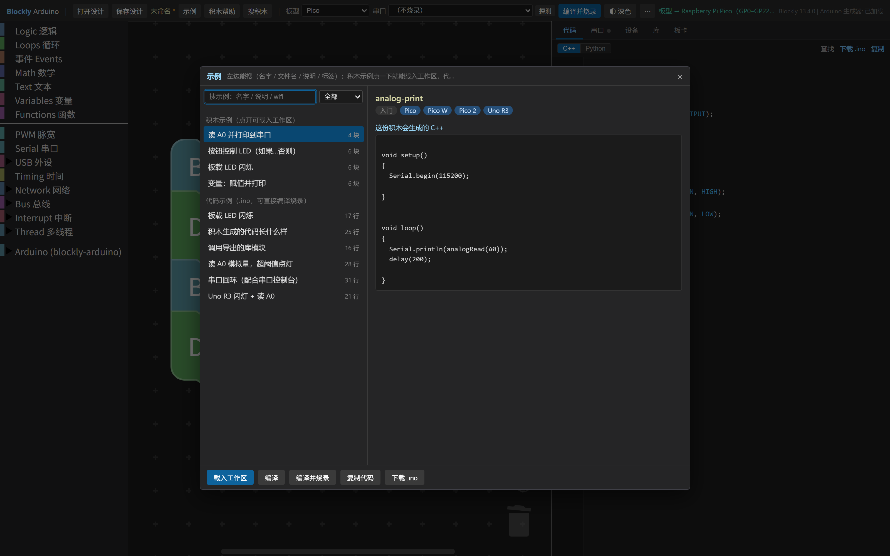
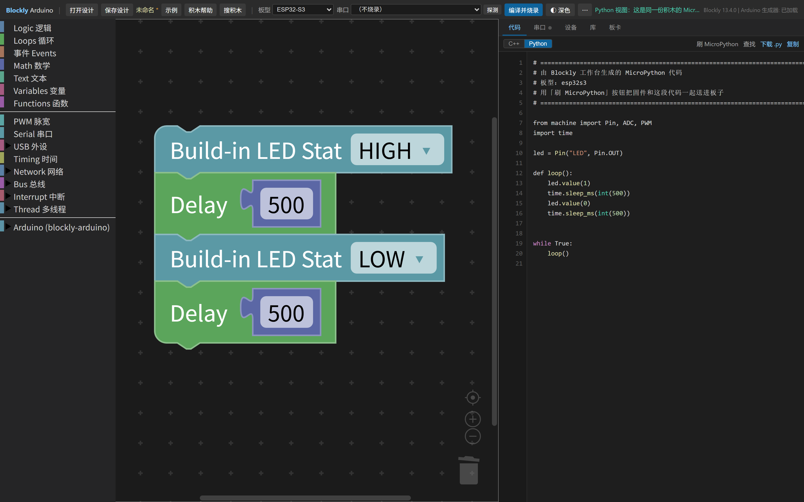

# Blockly 可视化编程工作台

**拖积木出 Arduino C++，一键编译烧录，全程不需要联网。**

面向 Raspberry Pi Pico / Pico W / Pico 2、Arduino Uno R3 和 ESP32-S3 的离线积木编程环境。
板卡核心、工具链、外置库、Node 运行时全部打包在仓库里，装机即用。

<div align="center">
  
  <br>
  <sub>左边拖积木，右边实时出代码，顶栏选板型、选串口、直接烧录</sub>
</div>

---

## 这是什么

一个把 Blockly 积木和真实单片机工具链缝在一起的工作台。你拖出来的每一块积木都会立刻变成
能烧进板子的 C++ —— 不是示意代码，是 arduino-cli 真正能编译通过、能跑在硬件上的代码。

它解决的是「教单片机编程时，环境装不起来」这件事：正常装一套 ESP32 + RP2040 + AVR 的环境，
要联网下载近 9 GB 的板卡核心和工具链，中间任何一步超时都会前功尽弃。这个包把这些全部预先装好，
拷到一台没有网络的 Windows 机器上，双击就能开始上课。

**核心特性**

- **积木即代码** —— 右侧代码区实时生成 C++，每一块积木对应的实现都看得见
- **真的能烧** —— 顶栏「编译并烧录」直接调本地 `arduino-cli`，不用另开 Arduino IDE
- **引脚不会错** —— 35 块电子积木的引脚下拉跟着板型变，Uno 上不出现 `GP15`，S3 上不出现 `GP22`
- **同一份积木，两种语言** —— 切到 Python 视图就是等价的 MicroPython，能直接刷进 Pico W / ESP32-S3
- **完全离线** —— 装完拔网线也能用，编译、烧录、串口监视全部本地完成

## 支持的硬件

| 板型 | 芯片 | 数字口 | ADC | PWM | 外部中断 |
| --- | --- | --- | --- | --- | --- |
| Raspberry Pi Pico | RP2040 | 27 | A0~A2 | 27 | — |
| Raspberry Pi Pico W | RP2040 + CYW43439 | 26 | A0~A2 | 26 | — |
| Raspberry Pi Pico W · BLE | RP2040 + 蓝牙 | 26 | A0~A2 | 26 | — |
| Raspberry Pi Pico 2 | RP2350 | 27 | A0~A2 | 27 | — |
| Arduino Uno R3 | ATmega328P | 20 | A0~A5 | 3/5/6/9/10/11 | 2、3 |
| ESP32-S3 | Xtensa LX7 | 33 | A0~A9（ADC1） | 33 | — |
| ESP32-S3 · USB | Xtensa LX7 + 硬件 CDC | 33 | A0~A9（ADC1） | 33 | — |

随包预装三套板卡核心：`arduino:avr 1.8.8`、`esp32 3.3.12`、`rp2040 6.3.1`（共 80,900 个文件），
以及 Servo、ESP32Servo、SerialLCD、EspSoftwareSerial、ghostl、PubSubClient 六个外置库。

完整位号表（35 块积木 × 5 种板型，每块给几项、默认落在哪个脚）见 **[积木清单.md](积木清单.md)**。

> 引脚下拉是**按板型静态生成**的，所以工具会提前挡掉几类必然踩的坑：Uno 的 PWM 只给 6 个脚、
> Uno 的外部中断只给 2/3、ESP32-S3 的 GP22~GP37（芯片上不存在或归 Flash/PSRAM）不出现。
> 舵机和蜂鸣器抢定时器这类运行时问题挡不住，但编译日志会打中文提示。

## 快速开始

### 1. 拿到这个包

```bash
git clone --depth 1 https://github.com/angle600/blockly-workbench-offline.git
```

约 1.9 GB（85 个 24 MiB 分卷，专为适配 GitHub 网页上传上限切的）。
只想看脚本、不需要板卡核心的话，用稀疏检出跳过 `volumes/`：

```bash
git clone --depth 1 --filter=blob:none --sparse https://github.com/angle600/blockly-workbench-offline.git
cd blockly-workbench-offline
git sparse-checkout set --no-cone '/*' '!/volumes'
```

### 2. 环境要求

| 项 | 要求 |
| --- | --- |
| 系统 | Windows 10 / 11 64 位 |
| 磁盘 | 安装后约占用 8.3 GB，建议留 9 GB 以上 |
| 网络 | **不需要**。板卡核心、工具链、Node 运行时都在包里 |
| 权限 | 装到 `D:\Program Files\Blockly` 这类普通目录，**不要**装进 `C:\Program Files` |

### 3. 安装

```
双击  pkg\一键安装.cmd
```

脚本自己判断装哪儿：pkg 在已装好的工作台里就就地修复，被单独拷走就装到
`D:\Program Files\Blockly`（没有 D 盘则用系统盘 `\Blockly`）。

装到别处或调整行为：

```cmd
pkg\一键安装.cmd -Target "E:\Tools\Blockly"   :: 指定安装目录
pkg\一键安装.cmd -NoIde                       :: 不装 Arduino IDE（省 540 MB）
pkg\一键安装.cmd -SkipVerify                  :: 跳过最后的自检
```

> **第一次装要等约 10 分钟**，时间几乎全花在把 85 个分卷解回 8.1 GB 的 `arduino15` 上。
> 解压是一次性的，已经解开的目录会跳过。pkg 必须放在可写位置（解压是写回 pkg 原地）。

装完会打印三行核心状态和自检结果，这样就是好的：

```
[+] arduino:avr   1.8.8    1.8.8  Arduino AVR Boards
[+] esp32:esp32   3.3.12   3.3.12 esp32
[+] rp2040:rp2040 6.3.1    6.3.1  Raspberry Pi Pico/RP2040/RP2350
[+] 板卡核心      3 / 3 就绪
[+] 外置库        5 / 5 就绪
[+] 自检通过
```

### 4. 启动

```
双击  安装目录里的  Start-Workbench.cmd
```

浏览器自动打开 **http://127.0.0.1:8765/**。关掉那个黑窗口就是退出。

> `Start-Workbench.cmd` 会先起一个本地构建服务，页面上的「编译并烧录」才能真正调到
> `arduino-cli`。另一个 `Start-Blockly.cmd` 直接打开 `app\index.html`，只能看代码和下载
> `.ino`，不能烧录 —— 日常请用前者。

## 使用方法

### 第一步：先选板型

顶栏右上角的下拉：**Pico / Pico W / Pico W · BLE / Pico 2 / Uno R3 / ESP32-S3 / ESP32-S3 · USB**。

**必须先选板型再拖积木。** 所有积木的引脚下拉都跟着板型变；换板型时已有积木的引脚会自动
映射到新板能用的脚上（映射了哪些会在状态栏说明）。反过来的话引脚会被改掉。

### 第二步：拖积木

从左边分类里拖，右边代码区实时更新。工具箱按用途分组：

| 分类 | 内容 |
| --- | --- |
| Logic / Loops / Events / Math / Text / Variables / Functions | Blockly 标准积木 |
| PWM 脉宽 | 占空比、频率 |
| Serial 串口 | 打印、读行、监视 |
| USB 外设 | 键盘、鼠标模拟（仅 ESP32-S3 的 TinyUSB 模式；`S3 · USB` 走硬件 CDC，只剩串口） |
| Timing 时间 | 延时、毫秒/微秒计时 |
| Network 网络 | WiFi、HTTP、MQTT |
| Bus 总线 | I2C、SPI |
| Interrupt 中断 | 外部中断计数、时间戳 |
| Thread 多线程 | 事件分发（注册/取消/投递）与硬件定时器 |

不确定某块积木干什么？**右键 →「查看帮助」**，或选中后按 **F1**，会告诉你它生成什么 C++。
找不到积木就按 **`/`** 搜（中文名、类型、关键词都能搜）。

### 第三步：编译并烧录

1. 用 USB 线把板子插上
2. 顶栏「串口」下拉里选出现的那个口（Pico 插上一般就会出；Uno 要先装好板上的 USB 转串口芯片驱动，CH340 或 ATmega16U2）
3. 点 **「编译并烧录」**

不确定接的是什么板子？点「探测」读芯片签名 —— Uno / Nano / Pro Mini 都是 ATmega328P，分不出型号，
但能确认「这是个能烧的 AVR」。

### 一个最小例子：让 Pico 上的板载 LED 闪

板型选 **Pico** → 拖「数字输出 LED 高」→「等待 500 毫秒」→「数字输出 LED 低」→「等待 500 毫秒」
→ 全塞进「一直重复」→ 点「编译并烧录」。

这就是内置示例里的「板载 LED 闪烁」，界面里「示例」→ 选它 →「载入工作区」可以一键载入。

## 内置示例库

<div align="center">
  
</div>

点顶栏「示例」。两类：

- **积木示例** —— 直接载入工作区，改一改就能烧
- **代码示例** —— 纯 `.ino`，可以直接编译烧录，也能当参考

每个示例都有中文标题、说明、难度和适用板型标签，支持搜索。

## MicroPython 视图

<div align="center">
  
</div>

代码区右上角切 **C++ / Python**。同一份积木，Python 视图给的是等价的 MicroPython，
用 `machine.Pin` / `time.sleep_ms` 那套写出来。

对能跑 MicroPython 的板子（Pico W / ESP32-S3），还能点「刷 MicroPython」——先给板子刷固件
（会抹掉现有的 C++ 程序），再把这段 Python 传上去直接运行。

## 导出与保存

| 顶栏入口 | 产物 |
| --- | --- |
| 保存设计（`Ctrl+S`） | 积木设计存进 `designs\`，可再打开 |
| 历史（`Ctrl+Shift+H`） | 当前设计的历次版本，可预览 / 还原 |
| 下载 `.ino` | 单个 Arduino 源文件 |
| 导出 Arduino（`Ctrl+Shift+E`） | `exports\<名字>\` 下完整工程：`.ino` + 积木文件 + README，双击就能用 Arduino IDE 打开 |
| 导出模块 | `.h` + `.cpp`，别的工程 `#include` 后调 `xxx_setup()` / `xxx_loop()` |
| 导出 PNG（`Ctrl+E`） | 把画布上的积木导出成 2 倍分辨率图片，按当前主题配色 |

`designs\` 和 `exports\` 是**用户数据目录**，卸载脚本默认不删。

## 卸载

```
双击  pkg\一键删除.cmd
```

会先列出要删的每一项和体积，要你亲手输入 `YES` 才动手，删完再问要不要回收 pkg 里那 8.5 GB 解压产物。

```cmd
pkg\一键删除.cmd -DryRun          :: 只列清单，不真删
pkg\一键删除.cmd -CleanPkgOnly    :: 只回收 pkg 里的解压产物，工作台继续用
pkg\一键删除.cmd -Target "E:\Tools\Blockly"
```

被脚本特意保护的是：`pkg\` 本体、`designs\`、`exports\`、`samples\`、`.workbuddy\`。

## 常见问题

**装完打开是空白页 / 一直转圈**
看那个黑窗口有没有报错。多半是端口被占用，关掉重复启动的窗口，或 `set PORT=8766` 再启动。

**编译报 `Platform 'arduino:avr' not found`**
板卡核心没找到。检查 `<安装目录>\arduino15\packages\` 下有没有 `arduino`、`esp32`、`rp2040`。
如果是把 pkg 压成 volumes 之后核心不见了，重跑一次 `一键安装.cmd` 让它解压回来。

**编译报 `Access is denied`**
装到了需要管理员权限的目录。换到普通目录装，或右键「以管理员身份运行」。

**安装很慢 / 卡在「解开 arduino15」**
8.1 GB 解压约 10 分钟，属正常。机械硬盘更久。

**Pico 插上但串口列表里没有**
按住 BOOTSEL 再插，或者换一根**能传数据**的 USB 线（很多线只供电）。

更多安装细节、目录说明、回滚方法、Arduino IDE 目录联接的踩坑记录，见 **[安装说明.md](安装说明.md)**。

## 仓库结构

```
.
├─ 一键安装.cmd          ← 双击安装
├─ 一键删除.cmd          ← 双击卸载 / 清理
├─ 更新安装包.cmd        ← 改了源码后把改动收进安装包
├─ install.ps1           安装主逻辑（含分卷还原、预检、自检）
├─ uninstall.ps1         卸载主逻辑
├─ manifest.json         版本 / 时间 / 各部分体积
├─ 安装说明.md           详细安装文档（含踩坑记录）
├─ 积木清单.md           35 块积木 × 5 种板型的位号表
├─ 校验清单.md           分卷完整性校验基准
├─ volumes\              85 个 24 MiB 分卷（安装时自动解开）
├─ config\               arduino-cli 配置模板
├─ docs\screenshots\     README 用的界面截图
└─ 工具\                 分卷打包/校验、积木清单生成、UnRAR.exe
```

> `volumes\` 里的分卷，安装时会原地解成 `arduino15 / runtime / npm / payload / libraries / ide`。
> 解完之后 `pkg` 会涨到约 10 GB，装完想回收可以用 `一键删除.cmd -CleanPkgOnly` 回到 1.9 GB。

## 许可

本包内的 Arduino 板卡核心、工具链、外置库分别遵循其原项目许可
（`arduino:avr` / `esp32` / `rp2040` 为 LGPL 或 Apache-2.0，各库见其 `library.properties`）。
`UnRAR.exe` 可自由分发，但不得用于重建 RAR 压缩算法。
